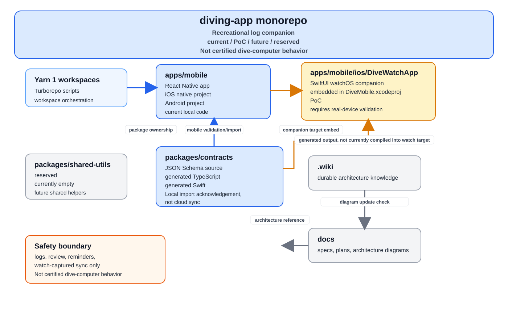
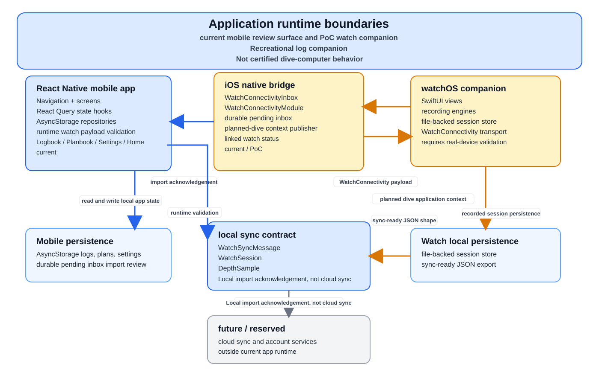
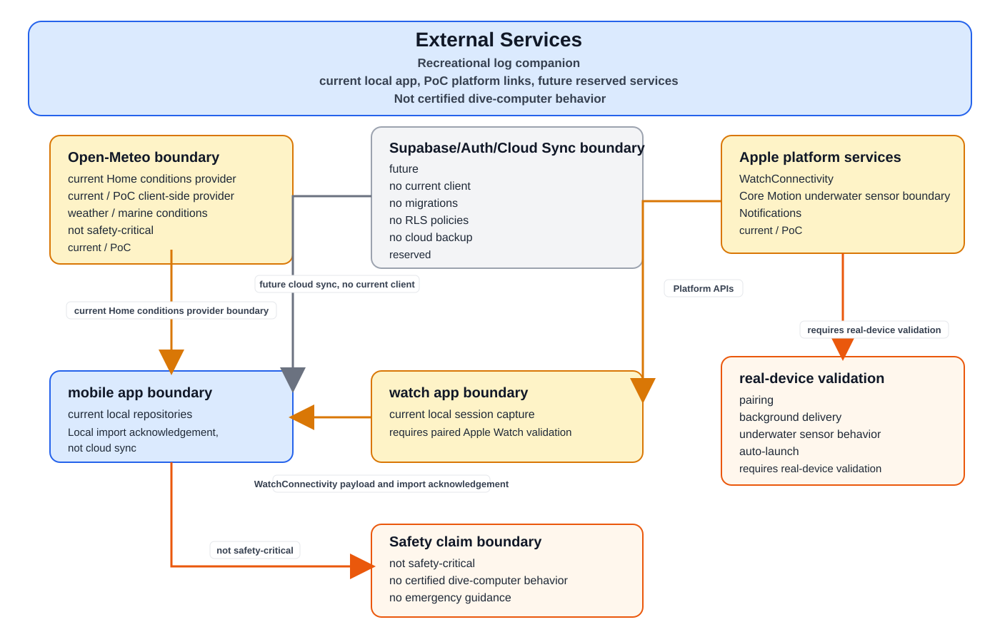

# Architecture Diagrams

This directory contains the editable draw.io source and Markdown-preview SVG exports for the current `diving-app` architecture.

The diagrams are a visual companion to `.wiki/wiki/architecture/*.md`. The wiki remains the durable textual architecture source.

## Overview

## Apps

## External Services

## Source

[Open the draw.io source](./architecture.drawio)

## Maintenance

- Edit `architecture.drawio`.
- Export each changed page to its matching SVG file.
- Keep current, PoC, future, reserved, and real-device-validation boundaries visually distinct.
- Do not show Supabase, auth, cloud sync, or cloud backup as implemented until code and wiki pages say they are implemented.
- Do not imply certified dive-computer, decompression-computer, medical, life-support, emergency decision, or certified equipment replacement behavior.

Update these diagrams when architecture work changes workspace responsibility, mobile/watch ownership, watch sync semantics, external service boundaries, Supabase/auth/cloud sync status, or safety-critical scope boundaries.
